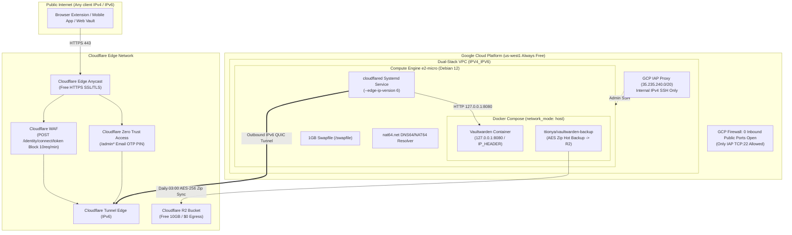

# VaultZero: AI Agent & Operator Runbook (`AGENTS.md`)

Welcome, AI Agent or Human Operator! This document provides complete context, architectural invariants, and executable playbooks to deploy, maintain, and troubleshoot **VaultZero** with zero ambiguity.

---

## 1. Project Overview & Architectural Intent

**VaultZero** is a turnkey, zero-cost ($0.00/month), zero-open-port, pure IPv6-native Vaultwarden deployment designed for Google Cloud Platform (GCP) Always Free tier (`e2-micro`), fronted by Cloudflare Tunnel, protected by Zero Trust Access/WAF, and backed up automatically to Cloudflare R2.



---

## 2. Non-Negotiable Invariants (AI Safety Guardrails)

When operating, refactoring, or automating VaultZero, you **MUST** strictly uphold the following rules:

1. **NEVER allocate an external IPv4 address (`--no-address`)**:
   - Google Cloud charges $0.005/hour (~$3.65/month) for external IPv4 addresses.
   - Always verify that the VM network interface has `accessConfigs: null`. External IPv6 is completely free ($0.00).
2. **NEVER open public ports (80/443) in the GCP firewall**:
   - All inbound traffic must traverse the outbound Cloudflare Tunnel.
   - The GCP firewall must only allow ingress on TCP port 22 from the GCP IAP CIDR: `35.235.240.0/20`.
3. **NEVER switch Docker Compose to bridge networking**:
   - Bridge networks rely on virtual IPv4 NAT and fail completely on pure IPv6 VMs when attempting outbound connections.
   - Always preserve `network_mode: "host"`.
4. **NEVER disable or remove `IP_HEADER=CF-Connecting-IP`**:
   - Vaultwarden must log real visitor IPs. Without this header, all traffic appears as `127.0.0.1`, which causes global lockouts under rate limiting.
5. **NEVER apply Cloudflare Managed Challenge (CAPTCHA) on `/api/*`**:
   - Bitwarden mobile apps and browser extensions cannot solve JavaScript challenges and will silently fail to sync. Use HTTP 429 rate limiting instead.
6. **Preserve RTO < 3 Minutes on Disaster Recovery**:
   - Standard AES decryption with `unzip` and `docker compose up -d` must fully restore data without cloud provider lock-in.

---

## 3. Repository File Map

| Path | Purpose |
| :--- | :--- |
| `vaultzero.sh` | **Unified CLI Entrypoint** for humans and AI agents (`status`, `verify`, `up`, `down`, `restart`, `backup`, `restore`, `setup`). |
| `docker-compose.yml` | Production Docker Compose file (`network_mode: host`, Vaultwarden + `ttionya/vaultwarden-backup`). |
| `.env.example` | Environment variable template (secrets, domain, argon2 tokens). |
| `rclone/rclone.conf.example` | S3 configuration template for Cloudflare R2. |
| `scripts/01-bootstrap-vm.sh` | Idempotent VM initialization (1GB swap, `nat64.net` DNS64/NAT64, Docker CE). |
| `scripts/02-setup-cloudflared.sh` | Installs `cloudflared` systemd service with `edge-ip-version: "6"` (supports token and local config). |
| `scripts/03-restore-backup.sh` | Disaster recovery script (pre-checks zip password, clears WAL, restores data, verifies health). |
| `scripts/verify-health.sh` | 6-point invariant security audit (checks IPv4 absence, closed ports, NAT64, 8080 health, real IP header). |
| `docs/gcp-deployment.md` | Step-by-step GCP provisioning runbook (`gcloud` CLI & Web Console). |
| `docs/cloudflare-setup.md` | Step-by-step Cloudflare Tunnel, WAF, Access OTP, and R2 setup runbook. |
| `docs/superpowers/specs/` | Formal design specification and architecture trade-offs. |
| `tests/` | Pytest test suite validating configurations, script syntax (`bash -n`), and security invariants. |

---

## 4. Agent Autonomous Deployment Playbook

If an agent is tasked with deploying VaultZero onto a fresh Google Cloud VM:

### Step 1: Provision the GCP VM (CLI Mode)
Execute the following `gcloud` commands (or guide the user):
```bash
# Set project and compute region
gcloud config set compute/region us-west1
gcloud config set compute/zone us-west1-b

# 1. Create dual-stack VPC network and subnet
gcloud compute networks create vpc-vaultzero --subnet-mode=custom
gcloud compute networks subnets create subnet-vaultzero \
    --network=vpc-vaultzero \
    --region=us-west1 \
    --range=10.10.0.0/24 \
    --stack-type=IPV4_IPV6 \
    --ipv6-access-type=EXTERNAL

# 2. Restrict firewall to IAP SSH only (35.235.240.0/20)
gcloud compute firewall-rules create allow-iap-ssh-vaultzero \
    --network=vpc-vaultzero \
    --allow=tcp:22 \
    --source-ranges=35.235.240.0/20 \
    --description="Allow SSH exclusively through Google Cloud IAP"

# 3. Provision e2-micro instance with NO external IPv4 (--no-address)
gcloud compute instances create vm-vaultzero \
    --zone=us-west1-b \
    --machine-type=e2-micro \
    --image-family=debian-12 \
    --image-project=debian-cloud \
    --boot-disk-size=30GB \
    --boot-disk-type=pd-standard \
    --network-interface=subnet=subnet-vaultzero,stack-type=IPV4_IPV6,no-address
```

### Step 2: Connect to VM via IAP
```bash
gcloud compute ssh vm-vaultzero --tunnel-through-iap --zone=us-west1-b
```

### Step 3: Clone Repository & Run Bootstrap
```bash
sudo apt-get update && sudo apt-get install -y git
git clone https://github.com/fewk/VaultZero.git /opt/vaultzero
cd /opt/vaultzero
sudo bash ./vaultzero.sh setup <YOUR_CLOUDFLARE_TUNNEL_TOKEN>
```

### Step 4: Configure Secrets & Start Containers
```bash
# 1. Prepare configuration directory
sudo cp /opt/vaultzero/docker-compose.yml /opt/vaultwarden/docker-compose.yml
sudo cp /opt/vaultzero/.env.example /opt/vaultwarden/.env

# 2. Edit .env (set DOMAIN, BACKUP_ZIP_PASS, ADMIN_TOKEN)
sudo nano /opt/vaultwarden/.env
sudo chmod 0600 /opt/vaultwarden/.env

# 3. Configure Rclone for Cloudflare R2 backup
sudo cp /opt/vaultzero/rclone/rclone.conf.example /opt/vaultwarden/rclone/rclone.conf
sudo nano /opt/vaultwarden/rclone/rclone.conf
sudo chmod 0600 /opt/vaultwarden/rclone/rclone.conf

# 4. Start services
cd /opt/vaultzero
sudo ./vaultzero.sh up
```

### Step 5: Verify Deployment Invariants
```bash
sudo ./vaultzero.sh verify
```
Expected output: **All 6 invariant checks PASSED (0 FAILURES)**.

---

## 5. Agent Troubleshooting Matrix

| Issue | Root Cause | Agent Action |
| :--- | :--- | :--- |
| `curl: (6) Could not resolve host` on IPv4-only domains (e.g. `github.com`) | DNS resolver reverted or DHCP overwritten `/etc/resolv.conf`. | Verify `/etc/resolv.conf` contains `2a01:4ff:f0:9876::1` (`nat64.net`). Run: `sudo bash scripts/01-bootstrap-vm.sh`. |
| `cloudflared` connection timeout to edge | Default IPv4 routing attempted on IPv6-only VM. | Confirm `edge-ip-version: "6"` is present in `/etc/cloudflared/config.yml` or service unit includes `--edge-ip-version 6`. |
| All Vaultwarden client IPs logged as `127.0.0.1` | Missing or overridden `IP_HEADER`. | Ensure `IP_HEADER=CF-Connecting-IP` is defined in `/opt/vaultwarden/docker-compose.yml` environment block. |
| Mobile Bitwarden App fails to sync (`Failed to fetch`) | Cloudflare WAF Managed Challenge / Turnstile enabled on `/api/*`. | Inspect Cloudflare WAF rules. Remove Managed Challenge on `/api/*`. Use HTTP 429 Rate Limiting on `POST /identity/connect/token` only. |
| Unexpected GCP billing charges | An external IPv4 address was attached. | Run `gcloud compute instances describe <VM> --format="value(networkInterfaces[0].accessConfigs)"`. If not null, detach the external IP immediately! |
| Container crashes with OOM (Out Of Memory) | `swapfile` was not activated. | Run `swapon --show`. If empty, run: `sudo bash scripts/01-bootstrap-vm.sh` to initialize the 1GB swap. |

---

## 6. Testing & CI Commands

To validate changes locally:
```bash
# Run full unit & integration test suite
python -m pytest tests/ -v

# Run syntax lint on all shell scripts
bash -n scripts/*.sh vaultzero.sh

# Validate docker-compose schema
docker compose -f docker-compose.yml config
```
