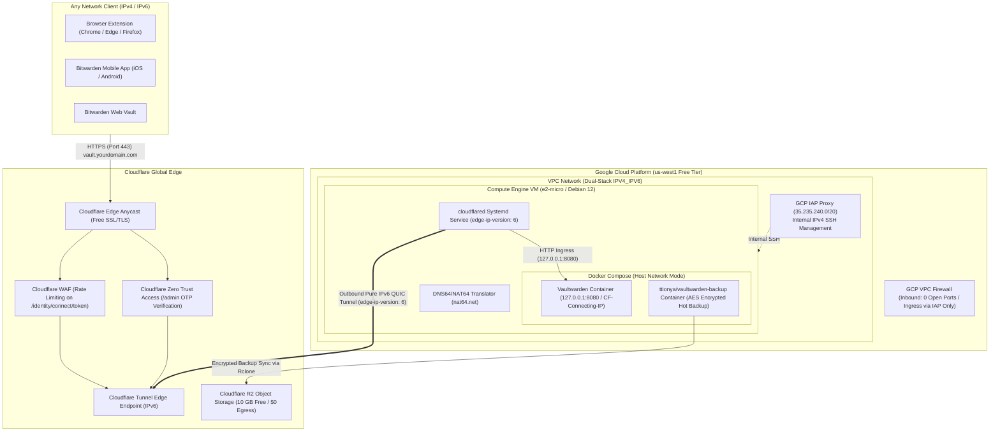

# VaultZero

<div align="center">

[](LICENSE)
[](https://cloud.google.com/free)
[](https://www.cloudflare.com/products/tunnel/)
[](#)
[](#)

[English](README.md) | [简体中文](README_CN.md)

<br>

**Turnkey, production-grade, $0.00/month self-hosted Vaultwarden on Google Cloud Platform Always Free with Cloudflare Tunnel, Zero Trust WAF, and automated Cloudflare R2 disaster recovery.**

</div>

---

## The Problem: The GCP "Always Free" Fee Trap

Google Cloud Platform offers a generous Always Free tier including one `e2-micro` instance, 30 GB standard persistent disk, and 1 GB outbound internet traffic per month in US regions (`us-west1`, `us-central1`, `us-east1`).

However, unsuspecting developers attempting to host Bitwarden / Vaultwarden routinely hit unexpected charges:

1. **IPv4 Address Surcharge**: GCP charges **$0.005/hour (~$3.65 – $3.72/month)** for in-use external IPv4 addresses. Running an instance with standard IPv4 invalidates the "$0 promise".
2. **NAT Gateway Costs**: Disabling public IPv4 and using GCP Cloud NAT incurs hourly gateway charges plus data processing fees.
3. **Public Port Exposure & Attack Surface**: Exposing ports 80/443 directly to the public internet requires Certbot management, leaves servers vulnerable to automated bot scans, and risks brute-force credential stuffing.
4. **Reverse Proxy Lockout Glitch**: Misconfigured proxies without `CF-Connecting-IP` report all client connections as `127.0.0.1`. A single user typing incorrect credentials can trigger Vaultwarden's rate limiter and lock out all users globally.

---

## The VaultZero Solution

VaultZero is engineered from the ground up to achieve **genuine $0.00/month operation**, invisible attack surface, and rock-solid reliability:

- **Pure External IPv6 Native ($0.00/month)**: Provisioned with `--no-address` (no external IPv4), allocating a free external `/96` IPv6 subnet on GCP Premium Tier.
- **Dual-Stack Internal VPC (`IPV4_IPV6`)**: Retains internal-only private IPv4 routing for GCP Identity-Aware Proxy (IAP), allowing admin SSH via `35.235.240.0/20` with zero open firewall ports.
- **Cloudflare Tunnel (`cloudflared`) over Pure IPv6**: The host establishes an outbound QUIC tunnel directly to Cloudflare edge nodes using `edge-ip-version: 6`. No incoming ports (80/443) are ever opened in the GCP firewall.
- **Universal IPv4/IPv6 Client Access**: Cloudflare Edge terminates incoming HTTPS traffic, issues free managed SSL/TLS certificates, and routes traffic from any client (IPv4 or IPv6) through the encrypted tunnel.
- **NAT64 / DNS64 Routing Gateway**: Configured with `nat64.net` dual-homed translation servers to allow pure-IPv6 VMs to pull updates and packages from IPv4-only repositories seamlessly.
- **Docker Host Networking (`network_mode: "host"`)**: Bypasses Docker's virtual bridge IPv4 routing deadlocks on pure IPv6 hosts, ensuring containers share host IPv6 and NAT64 routes directly.
- **Real Client IP Preservation**: Enforces `IP_HEADER=CF-Connecting-IP` in Vaultwarden so fail2ban and audit logs accurately identify remote clients instead of masking them behind `127.0.0.1`.
- **Zero-Lock Hot Backups to Cloudflare R2**: Accompanied by `ttionya/vaultwarden-backup` performing SQLite zero-lock hot backups with AES-256 encryption, uploaded to Cloudflare R2 (10 GB free storage, $0 egress fees) with 30-day retention.

---

## Architecture Overview



---

## Step-by-Step Deployment Guides

For detailed, production-grade deployment instructions, follow our comprehensive runbooks:

- 📖 **[GCP Always Free VM Deployment Guide](docs/gcp-deployment.md)**: Exact copy-pasteable `gcloud` CLI commands and GCP Web Console instructions to provision an `e2-micro` VM with dual-stack VPC (`IPV4_IPV6`), no public IPv4 (`--no-address`), and strict IAP firewall rules (`35.235.240.0/20`).
- 🛡️ **[Cloudflare Zero Trust, WAF & R2 Configuration Guide](docs/cloudflare-setup.md)**: Cloudflare Tunnel setup, public hostname routing (`127.0.0.1:8080`), WAF login rate limiting (`/identity/connect/token`), Zero Trust Access email OTP protection for `/admin`, and R2 encrypted backup configuration.

---

## 3-Step Quickstart

### Step 1: Provision GCP Always Free Instance

Follow the [GCP Deployment Guide](docs/gcp-deployment.md) to provision an `e2-micro` VM with dual-stack VPC (`IPV4_IPV6`), no external IPv4 (`--no-address`), a free `/96` external IPv6 subnet, 30 GB standard persistent disk, and firewall rules restricted to GCP IAP (`35.235.240.0/20`).

Connect to your instance securely via Google Cloud IAP SSH:

```bash
gcloud compute ssh vaultwarden-free --tunnel-through-iap --zone us-west1-b
```

### Step 2: Bootstrap VM & Cloudflare Tunnel

On the VM, configure NAT64 DNS so pure IPv6 can reach IPv4-only GitHub, clone this repository, and run automated setup:

```bash
sudo -i

# Set NAT64 DNS resolvers so pure-IPv6 VM can resolve and reach IPv4 endpoints (e.g. GitHub)
echo -e "nameserver 2a01:4ff:f0:9876::1\nnameserver 2001:67c:2960::64\nnameserver 2a00:1098:2b::1" > /etc/resolv.conf

# Clone repository and run automated bootstrap & tunnel installer
git clone https://github.com/fewk/VaultZero.git /opt/vaultzero
cd /opt/vaultzero
./vaultzero.sh setup YOUR_CLOUDFLARE_TUNNEL_TOKEN
```

### Step 2: Configure Domain & Launch Core Vault (Live in 3 Minutes)

Configure your public domain and start Vaultwarden immediately:

```bash
# 1. Copy environment template and configure your domain (DOMAIN=https://vault.yourdomain.com)
cp .env.example /opt/vaultwarden/.env
nano /opt/vaultwarden/.env
chmod 0600 /opt/vaultwarden/.env

# 2. Start Vaultwarden core service (launches cleanly even before backup is configured)
cd /opt/vaultzero
./vaultzero.sh up

# 3. Open registration temporarily to create your master admin account
./vaultzero.sh register on

# 4. Visit your domain in a browser and create your account!
# When done, immediately lock registration:
./vaultzero.sh register off

# 5. Run full 6-point invariant security & health audit
./vaultzero.sh verify
```

> 🎉 **Congratulations!** Your private Vaultwarden vault is now **100% operational and production-ready**. You can connect mobile apps and browser extensions right away.

---

### Step 3: (Strongly Recommended) Configure Offsite Disaster Recovery

Once your vault is running, configure automated offsite encrypted backups anytime:

#### Option A: Cloudflare R2 (Free 10GB / $0 Egress)
1. Create bucket `vaultwarden-backup` in Cloudflare Dashboard -> **R2**.
2. Create an R2 API Token with **Object Read & Write** permissions.
3. Configure Rclone:
   ```bash
   cp rclone/rclone.conf.example /opt/vaultwarden/rclone/rclone.conf
   nano /opt/vaultwarden/rclone/rclone.conf  # Enter Access Key ID and Secret Access Key
   chmod 0644 /opt/vaultwarden/rclone/rclone.conf
   ```
4. Set AES zip encryption password `BACKUP_ZIP_PASS` in `/opt/vaultwarden/.env`.
5. Restart and trigger immediate backup test:
   ```bash
   ./vaultzero.sh restart
   ./vaultzero.sh backup
   ```

#### Option B: WebDAV or Multi-Cloud Dual Backup (InfiniCLOUD / Synology NAS / Nextcloud)
1. **Obscure WebDAV Password**:
   ```bash
   docker exec vaultwarden-backup rclone obscure "your_plain_password"
   ```
2. **Append WebDAV Remote to `/opt/vaultwarden/rclone/rclone.conf`**:
   ```ini
   [webdav]
   type = webdav
   url = https://dav.example.com/dav/
   vendor = other
   user = your_username
   pass = <obscured_password_from_step_1>
   ```
3. **Enable Secondary Remote in `/opt/vaultwarden/.env`**:
   ```bash
   echo "RCLONE_REMOTE_NAME_1=webdav" >> /opt/vaultwarden/.env
   echo "RCLONE_REMOTE_DIR_1=/vaultwarden-backup" >> /opt/vaultwarden/.env
   ```
4. **Restart & Trigger Dual Backup**:
   ```bash
   ./vaultzero.sh restart
   docker exec vaultwarden-backup /app/backup.sh
   ```

---

Follow the [Cloudflare Setup Guide](docs/cloudflare-setup.md) to enable WAF rate limiting on `/identity/connect/token` and protect `/admin` with Zero Trust Email OTP.

---

## Directory Hierarchy

```text
VaultZero/
├── AGENTS.md                 # AI agent runbook & autonomous deployment guidelines
├── vaultzero.sh              # Unified operator & agent management CLI
├── .env.example              # Sample environment configuration template
├── .gitignore                # Git exclusions for secrets and runtime data
├── LICENSE                   # MIT License
├── README.md                 # Project architecture and operations guide (English)
├── README_CN.md              # Project architecture and operations guide (Chinese)
├── docker-compose.yml        # Docker Compose orchestration (Vaultwarden + Backup)
├── docs/                     # Architecture specifications and implementation runbooks
│   ├── cloudflare-setup.md   # Cloudflare Tunnel, WAF, Zero Trust & R2 runbook
│   ├── gcp-deployment.md     # GCP Always Free VM & dual-stack VPC runbook
│   └── superpowers/
│       ├── plans/            # Implementation plans
│       └── specs/            # Engineering specifications
├── rclone/                   # Rclone configuration templates for Cloudflare R2
│   └── rclone.conf.example
├── scripts/                  # Automated host lifecycle and operational scripts
│   ├── 01-bootstrap-vm.sh    # DNS64/NAT64, swap, Docker, and filesystem bootstrap
│   ├── 02-setup-cloudflared.sh # Cloudflare Tunnel IPv6 service installer
│   ├── 03-restore-backup.sh  # Zero-downtime disaster recovery & restore drill (< 3 min)
│   └── verify-health.sh      # Security invariant and architecture health auditor
└── tests/                    # Automated test harness (pytest)
```

---

## AI Agent Integration

This repository includes [`AGENTS.md`](AGENTS.md) — a dedicated operational runbook specifically tailored for autonomous AI agents (Antigravity, Claude Code, Cursor, Copilot, Cline, Windsurf, Aider). It defines core invariant safety guardrails, step-by-step autonomous execution playbooks, troubleshooting heuristics, and health audit verification procedures.

---

## Security & Operations CLI

Use `./vaultzero.sh` for routine maintenance:

- **Check Status**: `./vaultzero.sh status` (containers, tunnel service, memory & port health).
- **Security Audit**: `./vaultzero.sh verify` (run 6-point invariant security audit).
- **Trigger Backup**: `./vaultzero.sh backup` (instant hot backup to Cloudflare R2).
- **Disaster Recovery**: `./vaultzero.sh restore --latest` (sub-3-minute recovery drill).
- **Live Logs**: `./vaultzero.sh logs vaultwarden` (or `backup` / `tunnel`).
- **Updates**: Run `docker compose pull && ./vaultzero.sh restart` to upgrade containers with zero data loss.

---

## License

This project is licensed under the [MIT License](LICENSE).
