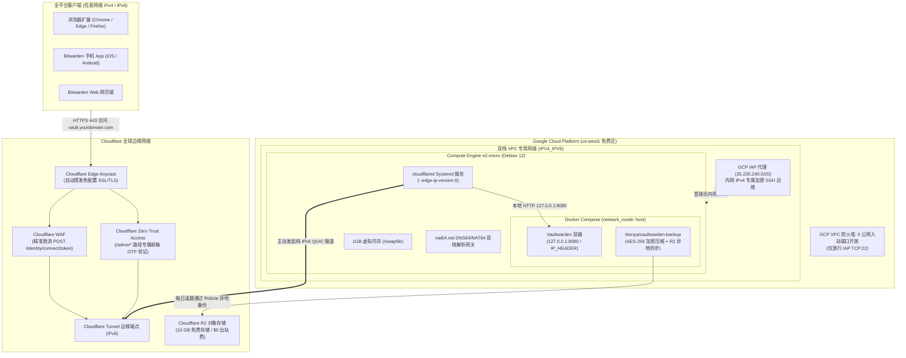

# VaultZero

<div align="center">

[](LICENSE)
[](https://cloud.google.com/free)
[](https://www.cloudflare.com/products/tunnel/)
[](#)
[](#)

[English](README.md) | [简体中文](README_CN.md)

<br>

**开箱即用、生产级安全、终身 $0.00/月成本的私有密码库方案。基于 Google Cloud Platform 永久免费套餐 (Always Free)、Cloudflare 隧道加密穿透、Zero Trust 边缘防护与 Cloudflare R2 异地全自动容灾热备。**

</div>

---

## 项目背景：GCP“永久免费”的计费陷阱

Google Cloud Platform (GCP) 提供了业界极其慷慨的“永久免费套餐 (Always Free)”，包含 1 台 `e2-micro` 云服务器（us-west1 / us-central1 / us-east1 区域）、30 GB 标准永久磁盘（pd-standard）以及每月免费出站流量。

然而，许多开发者在尝试自建 Bitwarden / Vaultwarden 密码库时，往往会遭遇意料之外的扣费账单：

1. **IPv4 公网地址租赁陷阱**：自 2024 年 2 月起，GCP 对所有外部 IPv4 地址加收 **$0.005/小时（约 $3.65 - $3.72/月）** 的租金。只要给服务器绑定了外网 IPv4，原本“$0 免费”的承诺便荡然无存。
2. **NAT 网关高额隐形扣费**：若不绑定外网 IPv4 而转用 GCP Cloud NAT 出网，GCP 会收取 NAT 网关小时费及数据流量处理费。
3. **公网暴露 80/443 端口与黑客扫描**：传统建站需要向公网开放 80/443 端口并配置 Certbot，导致服务器持续暴露在全网全端口自动化撞库、端口扫描与漏洞探测的火力之下。
4. **反向代理 127.0.0.1 全局误封**：未配置真实客户端透传的反向代理会导致 Vaultwarden 内部记录的所有请求来源全部为 `127.0.0.1`。一旦某个客户端输错密码触发防爆破限流，会导致全平台所有客户端同步遭到全局封禁。

---

## VaultZero 架构解法

VaultZero 从底层网络拓扑与安全防护出发，实现真正**绝对的 $0.00/月终身免费**、全网隐形防御与企业级高可用：

- **纯公网 IPv6 原生驱动（$0.00/月）**：创建虚拟机时严格指定 `--no-address`（绝不绑定收费的外部 IPv4），依托 GCP 免费分配的公网 `/96` IPv6 子网出网。
- **双栈内网 VPC 专属安全通道（`IPV4_IPV6`）**：子网保留内网私有 IPv4，专供 Google Cloud IAP（Identity-Aware Proxy 身份识别代理，`35.235.240.0/20`）进行内网隧道 SSH 运维，防火墙无需向公网开放任何管理端口。
- **Cloudflare 纯 IPv6 QUIC 隧道反向穿透**：由虚拟机内部的 `cloudflared` 守护进程主动向 Cloudflare 边缘节点发起纯 IPv6 (`--edge-ip-version 6`) QUIC 加密长连接。GCP 防火墙对公网完全关闭 80/443 业务端口，实现“零开放端口”公网完全隐身。
- **全平台终端无感访问（全网 IPv4/IPv6 客户端秒级互通）**：所有终端请求（手机 App、浏览器插件、网页端）均由 Cloudflare 边缘 Anycast 节点接入，自动颁发受信任 SSL/TLS 证书，经由隧道加密送达虚拟机，无论客户端处于纯 IPv4 还是 IPv6 环境均秒级同步。
- **NAT64 / DNS64 出网网关**：内置 `nat64.net` 双节点转换解析，使纯 IPv6 虚拟机能够无感访问 IPv4-only 站点（如 GitHub、Docker 镜像源）。
- **Docker 主机网络模式（`network_mode: "host"`）**：彻底规避 Docker 默认 IPv4 Bridge 虚拟网桥在纯 IPv6 宿主机上的网络死锁，直接复用宿主机的高性能 IPv6 与 NAT64 路由栈。
- **真实客户端 IP 透传**：显式注入 `IP_HEADER=CF-Connecting-IP`，让 Vaultwarden 精确识别外部访客的真实 IP，审计日志真实可查，杜绝 `127.0.0.1` 全局连带封禁。
- **Cloudflare R2 异地无锁热备**：整合 `ttionya/vaultwarden-backup` 伴生容器，每日凌晨执行 SQLite 安全热备，采用高强度 AES-256 压缩加密，直接推送到 Cloudflare R2（每月 10 GB 免费存储、0 出站费用），支持 30 天自动循环淘汰。
- **灾难极速恢复（RTO < 3 分钟）**：提供一键解密还原脚本，无论是在原机还是任意异地主机，单条命令即可从 R2 拉取最新快照秒级复活。

---

## 系统拓扑架构图



---

## 快速实战部署指南（3 步完成上线）

### 前置准备

1. 一个拥有 **Google Cloud Platform (GCP)** 账号的云项目（已开通结算账户以启用 Always Free 资格）。
2. 一个托管在 **Cloudflare** 的独立域名，并开通免费的 **Cloudflare Zero Trust**。

详细分步指导文档请参阅：
- 📖 [GCP Always Free 虚拟机与双栈 VPC 部署实战指南](docs/gcp-deployment.md)
- 📖 [Cloudflare 隧道、WAF 规则与 R2 备份配置指南](docs/cloudflare-setup.md)

---

### 第一步：创建纯 IPv6 GCP 免费虚拟机

在 [GCP 控制台](https://console.cloud.google.com/) 右上角打开 **Cloud Shell**，执行以下 3 条指令：

```bash
# 1. 创建双栈 VPC 网络与子网
gcloud compute networks create vpc-vaultzero --subnet-mode=custom
gcloud compute networks subnets create subnet-vaultzero \
    --network=vpc-vaultzero \
    --region=us-west1 \
    --range=10.10.0.0/24 \
    --stack-type=IPV4_IPV6 \
    --ipv6-access-type=EXTERNAL

# 2. 配置防火墙：公网端口 0 开放，仅允许 GCP IAP 内网 SSH
gcloud compute firewall-rules create allow-iap-ssh-vaultzero \
    --network=vpc-vaultzero \
    --allow=tcp:22 \
    --source-ranges=35.235.240.0/20 \
    --description="Allow SSH exclusively through Google Cloud IAP"

# 3. 创建 e2-micro 实例（严格指定 --no-address 彻底规避 IPv4 租金）
gcloud compute instances create vm-vaultzero \
    --zone=us-west1-b \
    --machine-type=e2-micro \
    --image-family=debian-12 \
    --image-project=debian-cloud \
    --boot-disk-size=30GB \
    --boot-disk-type=pd-standard \
    --network-interface=subnet=subnet-vaultzero,stack-type=IPV4_IPV6,no-address
```

通过 IAP 连入虚拟机：

```bash
gcloud compute ssh vm-vaultzero --tunnel-through-iap --zone=us-west1-b
```

---

### 第二步：配置 NAT64、拉取项目并自动化安装

连入虚拟机后切换至 root 用户，先注入 NAT64 DNS（以便在纯 IPv6 机器上正常连接仅支持 IPv4 的 GitHub），随后执行一键安装：

```bash
sudo -i

# 1. 注入公共 NAT64 解析，打通 IPv4 站点访问（例如 GitHub）
echo -e "nameserver 2a01:4ff:f0:9876::1\nnameserver 2001:67c:2960::64\nnameserver 2a00:1098:2b::1" > /etc/resolv.conf

# 2. 克隆项目仓库
git clone https://github.com/fewk/VaultZero.git /opt/vaultzero
cd /opt/vaultzero

# 3. 按照 docs/cloudflare-setup.md 创建隧道并获取 Token，执行全自动安装：
./vaultzero.sh setup YOUR_CLOUDFLARE_TUNNEL_TOKEN
```

配置环境变量与 R2 备份密钥：

```bash
# 拷贝并编辑环境变量文件
cp .env.example /opt/vaultwarden/.env
nano /opt/vaultwarden/.env
chmod 0600 /opt/vaultwarden/.env

# 配置 Cloudflare R2 对象存储密钥（供自动热备使用，容器以 UID 1100 运行需读权限）
cp rclone/rclone.conf.example /opt/vaultwarden/rclone/rclone.conf
nano /opt/vaultwarden/rclone/rclone.conf
chmod 0644 /opt/vaultwarden/rclone/rclone.conf
```

---

### 第三步：启动金库服务与安全巡检

```bash
cd /opt/vaultzero

# 启动 VaultZero 容器服务
./vaultzero.sh up

# 临时开启新用户注册以创建首个主管理员账号
./vaultzero.sh register on

# 浏览器访问您的域名（例如 https://vault.yourdomain.com）创建主账号！
# 注册成功后，立即关闭公网注册锁死大门（确保金库私有独占）：
./vaultzero.sh register off

# 执行安全与健康巡检，验证 0 公网 IPv4 扣费与 0 端口暴露
./vaultzero.sh verify
```

最后参考 [Cloudflare 配置指南](docs/cloudflare-setup.md) 为 `/identity/connect/token` 部署防暴破 WAF 限流规则，并为 `/admin*` 启用邮箱 OTP 双因素认证保护！

---

### 进阶：多云异地容灾备份（Cloudflare R2 + WebDAV 双备份）

如果您希望在 Cloudflare R2 的基础上，同时备份到私有 WebDAV（如 InfiniCLOUD / 坚果云 / 群晖 NAS / Nextcloud）：

1. **生成 WebDAV 加密密码**：
   ```bash
   # Rclone 要求密码经过混淆加密存储，运行以下命令获取密文：
   docker exec vaultwarden-backup rclone obscure "您的WebDAV明文密码"
   ```
2. **在 `/opt/vaultwarden/rclone/rclone.conf` 追加 WebDAV 配置**：
   ```ini
   [webdav]
   type = webdav
   url = https://dav.example.com/dav/
   vendor = other
   user = 您的用户名
   pass = <上方生成的混淆密文>
   ```
3. **在 `/opt/vaultwarden/.env` 启用第二远端**：
   ```bash
   echo "RCLONE_REMOTE_NAME_1=webdav" >> /opt/vaultwarden/.env
   echo "RCLONE_REMOTE_DIR_1=/vaultwarden-backup" >> /opt/vaultwarden/.env
   ```
4. **重启并验证双云备份**：
   ```bash
   ./vaultzero.sh restart
   docker exec vaultwarden-backup /app/backup.sh
   ```

---

## 目录结构说明

```text
VaultZero/
├── AGENTS.md                 # AI 代理行动准则与自主部署运维剧本
├── vaultzero.sh              # 统一命令行运维与管理入口工具
├── .env.example              # 环境变量配置模板
├── .gitignore                # 敏感配置文件与运行时数据排除规则
├── LICENSE                   # MIT 开源授权协议
├── README.md                 # 英文官方文档
├── README_CN.md              # 简体中文官方文档
├── docker-compose.yml        # Docker Compose 容器编排文件 (Host 模式)
├── docs/                     # 架构规范与生产部署实战指南
│   ├── cloudflare-setup.md   # Cloudflare 隧道、WAF、Access 与 R2 配置指南
│   ├── gcp-deployment.md     # GCP Always Free 虚拟机与双栈 VPC 操作手册
│   └── superpowers/
│       ├── plans/            # 详细开发实施计划
│       └── specs/            # 完整工程设计规范文档
├── rclone/                   # Cloudflare R2 对象存储 Rclone 配置模板
│   └── rclone.conf.example
├── scripts/                  # 宿主机生命周期自动化脚本
│   ├── 01-bootstrap-vm.sh    # DNS64/NAT64、Swap、Docker 环境初始化脚本
│   ├── 02-setup-cloudflared.sh # Cloudflare 纯 IPv6 隧道安装与服务管理脚本
│   ├── 03-restore-backup.sh  # 异地容灾解密恢复脚本 (RTO < 3 分钟)
│   └── verify-health.sh      # 6 重架构不变性与安全性自动化巡检脚本
└── tests/                    # 完整自动化测试套件 (Pytest)
```

---

## 统一运维管理 CLI (`vaultzero.sh`)

本项目提供高度封装的统一 CLI 工具，无论是人类操作员还是 AI Agent 均可轻松管理：

```bash
./vaultzero.sh status         # 查看容器、隧道服务、端口与内存 Swap 状态
./vaultzero.sh verify         # 运行 6 重安全与不变性巡检（确认 $0 成本与 0 端口暴露）
./vaultzero.sh register on    # 临时开启新用户注册（自动重启加载）
./vaultzero.sh register off   # 关闭新用户注册（安全锁死）
./vaultzero.sh backup         # 立即触发一次全量无锁热备并同步到 Cloudflare R2
./vaultzero.sh restore        # 执行极速容灾恢复（RTO < 3 分钟）
./vaultzero.sh up / down      # 启动 / 停止金库容器
./vaultzero.sh restart        # 重启服务并强制重载配置
./vaultzero.sh logs [service] # 实时查看容器或隧道日志（vaultwarden / backup / tunnel）
```

---

## AI Agent 专属集成支持

本项目原生包含 [`AGENTS.md`](AGENTS.md) 运维规范，专为各类自主 AI 编程与运维助手（如 Antigravity、Claude Code、Cursor、Copilot、Windsurf、Aider）设计。定义了核心安全红线守则、自动开机与部署步骤、智能故障诊断矩阵以及验收核查标准。

---

## 授权协议

本项目采用 [MIT License](LICENSE) 开源授权。
