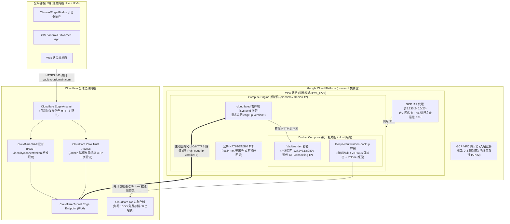

# Design Document: Self-Hosted Vaultwarden on GCP Always Free (Pure IPv6 + Cloudflare Tunnel)

## 1. 概述与设计目标 (Overview & Objectives)

本项目旨在利用 Google Cloud Platform (GCP) 的 **Always Free（永久免费）** 资源，搭配 **Cloudflare Tunnel** 与自己的独立域名，搭建一个具备生产级高可用、极致安全、完全零月租（$0.00/月）、零入站端口暴露的私有密码库（Vaultwarden，Bitwarden 官方兼容开源实现）。

同时，本项目全面吸收 GitHub 顶级开源密码库备份方案 **`ttionya/vaultwarden-backup`**，实现容器化全自动加密备份、云端增量留存与故障报警。

### 核心约束与工程目标
1. **绝对 $0 费用**：绝不分配收费的外部 IPv4（$0.005/小时），采用免费的外部 IPv6；利用 GCP Premium Tier 每月 1GB 免费出站配额（密码库月均同步流量 < 50MB）。
2. **零端口暴露（隐形安全）**：GCP 防火墙关闭所有入站业务端口（80/443），完全依靠虚拟机内部的 `cloudflared` 客户端通过纯 IPv6 向 Cloudflare Edge 发起单向长连接建立加密隧道。
3. **真实客户端 IP 透传**：显式配置 `IP_HEADER=CF-Connecting-IP`，确保审计日志真实溯源，彻底杜绝因源 IP 全为 `127.0.0.1` 导致全局误封的致命隐患。
4. **全网终端秒级同步**：Cloudflare 边缘节点终结外部客户端连接并自动颁发受信任 SSL/TLS 证书。无论客户端身处纯 IPv4 还是 IPv6 网络，均可秒级无感同步。
5. **企业级伴生备份生态**：引入 `ttionya/vaultwarden-backup` 伴生容器，原生热备 SQLite、附件、密钥及发送数据，集成 AES 密码压缩与 Cloudflare R2 异地存储，支持 30 天自动滚动淘汰。
6. **纯 IPv6 容器网络穿透**：采用 `network_mode: "host"` 架构，让 Docker 容器直接继承宿主机的纯 IPv6 与 NAT64 网关能力，彻底规避 Docker 默认 IPv4 Bridge 虚拟网络在纯 IPv6 宿主机下的出网死锁。

---

## 2. 总体架构与网络拓扑 (Architecture & Network Topology)



---

## 3. 基础设施规格 (Infrastructure Specifications)

| 资源项 | 配置值 | 计费与工程关键点 |
| :--- | :--- | :--- |
| **云服务商** | Google Cloud Platform (GCP) | 依托现有 Always Free 项目 |
| **地理区域** | `us-west1`（俄勒冈） | Always Free 官方指定免费区域之一 |
| **机器规格** | `e2-micro`（2 vCPU 突发，1GB 内存） | Always Free 规则下每个月 744 小时全额抵扣 |
| **操作系统** | Debian 12 (bookworm) 最小化镜像 | 官方免费标准镜像 |
| **磁盘规格** | 30 GB `pd-standard`（标准永久磁盘） | Always Free 免费磁盘限额为 30GB（全额抵扣） |
| **虚拟内存** | 1GB Linux Swap (`/swapfile`) | 防止 Docker 或镜像拉取内存偶发抖动导致 OOM |
| **公网 IPv4** | **无（`--no-address`）** | **彻底省去 $3.65/月（$0.005/小时）的外部 IP 租金** |
| **子网栈类型** | **`IPV4_IPV6`（双栈模式）** | **关键防坑**：必须分配内部私有 IPv4，以支撑 GCP IAP SSH（`35.235.240.0/20`）路由正常连入；同时分配免费的公网 `/96` IPv6。切勿配置为 `IPV6_ONLY` |
| **公网 IPv6** | 启用 External IPv6（`/96` 子网） | **免费分配（$0.00）** |
| **网络层级** | Premium Tier（IPv6 唯一支持层级） | 享有每月 **1 GB 免费出站流量**（密码库月均同步 < 50MB，远低于限额） |
| **入站防火墙** | 关闭所有公开业务端口（0 暴露） | 仅放行来自 IAP 网段（`35.235.240.0/20`）的 TCP:22 供远程管理 |

---

## 4. 服务容器与安全加固 (Service & Security Hardening)

### 4.1 纯 IPv6 机器的出网网关适配 (带转发网关的 NAT64/DNS64)
纯 IPv6 虚拟机访问纯 IPv4 站点（如 GitHub、Debian 部分 IPv4 镜像源）时，必须依赖**自带 NAT64 路由转换网关**的公共服务（而非仅做合成的 Google/Cloudflare DNS64）：
`/etc/resolv.conf` 配置：
```text
nameserver 2a01:4ff:f0:9876::1   # nat64.net (美东 Ashburn 节点，自带公共 NAT64 转发网关)
nameserver 2a00:1098:2b::1       # nat64.net (阿姆斯特丹冗余节点)
nameserver 2606:4700:4700::1111  # Cloudflare 纯 IPv6 兜底解析
```

### 4.2 Docker Compose 联合编排（包含 Vaultwarden + ttionya 备份服务）

持久化数据与备份配置统一规范在 `/opt/vaultwarden` 体系下：
- 数据目录：`/opt/vaultwarden/data`
- 备份配置目录：`/opt/vaultwarden/env`
- Rclone 配置文件：`/opt/vaultwarden/rclone`

`/opt/vaultwarden/docker-compose.yml`:
```yaml
version: '3.8'

services:
  vaultwarden:
    image: vaultwarden/server:latest
    container_name: vaultwarden
    restart: unless-stopped
    network_mode: "host"                 # 关键设计：共享宿主机网络，直接继承 IPv6 与本地通信
    environment:
      - ROCKET_PORT=8080                 # 监听本地 8080 端口
      - DOMAIN=https://vault.yourdomain.com
      - SIGNUPS_ALLOWED=false            # 首个管理员账号注册完成后立刻置为 false
      - INVITATIONS_ALLOWED=false        # 禁用外部邀请
      - SHOW_PASSWORD_HINT=false         # 登录界面禁用密码提示
      - IP_HEADER=CF-Connecting-IP       # 关键加固：透传真实客户端 IP，杜绝 127.0.0.1 全局误封
      - LOGIN_RATELIMIT_MAX_BURST=10     # 原生登录防暴破：突发最大尝试 10 次
      - LOGIN_RATELIMIT_SECONDS=60       # 原生登录防暴破：时间窗口 60 秒
      - LOG_LEVEL=warn
      - EXTENDED_LOGGING=true
      # 如需启用 /admin 管理后台，使用 Argon2 PHC 格式并对 $ 符号双写转义：
      # - ADMIN_TOKEN=$$argon2id$$v=19$$m=65540,t=3,p=4$$...
    volumes:
      - /opt/vaultwarden/data:/data
    logging:
      driver: "json-file"
      options:
        max-size: "10m"                  # 严格限制容器日志大小，防撑爆 30GB 磁盘
        max-file: "3"

  backup:
    image: ttionya/vaultwarden-backup:latest
    container_name: vaultwarden-backup
    restart: unless-stopped
    network_mode: "host"                 # 共享网络栈以直接通过宿主机 IPv6 + NAT64 推送云端
    depends_on:
      - vaultwarden
    environment:
      - CRON=0 3 * * *                   # 每天凌晨 03:00 自动执行热备
      - ZIP_PASSWORD=${BACKUP_ZIP_PASS}  # AES 加密压缩密码（通过 .env 读取，防泄露）
      - BACKUP_KEEP_DAYS=30              # 自动清理 30 天前的异地历史备份
      - RCLONE_REMOTE_NAME=r2:vaultwarden-backup  # 对应的 Rclone 远端配置名与 Bucket
      - TIMEZONE=Asia/Shanghai
      # 可选通知组件（备份成功/失败自动推送）
      # - TELEGRAM_BOT_TOKEN=${TG_BOT_TOKEN}
      # - TELEGRAM_CHAT_ID=${TG_CHAT_ID}
    volumes:
      - /opt/vaultwarden/data:/vaultwarden/data:ro  # 只读挂载密码库数据目录
      - /opt/vaultwarden/rclone:/config/rclone      # 挂载 rclone.conf
    logging:
      driver: "json-file"
      options:
        max-size: "5m"
        max-file: "2"
```

### 4.3 Cloudflare Tunnel 纯 IPv6 路由配置
在宿主机部署 `cloudflared`（以 Systemd 原生服务运行，内存仅 ~40MB），在 `/etc/cloudflared/config.yml` 中显式指定 `edge-ip-version: "6"`，杜绝 IPv4 边缘超时：

```yaml
tunnel: <TUNNEL_UUID>
credentials-file: /root/.cloudflared/<TUNNEL_UUID>.json
edge-ip-version: "6"                     # 关键加固：强制使用纯 IPv6 连接 Cloudflare 边缘节点
protocol: quic

ingress:
  - hostname: vault.yourdomain.com
    service: http://127.0.0.1:8080
  - service: http_status:404
```

### 4.4 Cloudflare 边缘安全防护 (WAF & Zero Trust 精准规则)
1. **防暴破限流精准收敛**：
   - **禁止**对 `/api/*` 盲目启用验证码（Managed Challenge），防止手机 App/插件同步崩溃；
   - **精确匹配登录端点**：`(http.request.uri.path eq "/identity/connect/token" and http.request.method eq "POST")`；
   - **拦截动作**：设为 **`Block`（直接返回 HTTP 429 速率超限）**，阈值设为 1 分钟内同一 IP 超过 10 次请求直接阻断。
2. **管理后台隔离（Cloudflare Access）**：
   - 保护路径：`vault.yourdomain.com/admin*`；
   - 规则：仅允许向指定所有者邮箱发送一次性 PIN 验证码，验证成功后方可进入管理员面板。

---

## 5. 异地容灾备份机制 (Disaster Recovery & Backup)

### 5.1 `ttionya/vaultwarden-backup` 的工作逻辑与优势
通过容器化集成，备份流程具备以下全自动特性：
1. **零锁表热备**：在容器内直接调用 SQLite 安全热备机制导出快照，写入时绝对不中断密码库正常读写；
2. **多资产全量覆盖**：自动打包并同步 `db.sqlite3`、`attachments/`（附件）、`sends/`（临时分享文件）、`rsa_key*` 密钥对与 `config.json`；
3. **AES-256 强加密打包**：所有数据在流式传输前被压缩为带密码保护的高强度 `.zip` 归档文件；
4. **云端生命周期管理**：通过内嵌的 `rclone` 直接对接免费的 Cloudflare R2（每月 10GB 免费存储额度），本地与云端自动执行 `BACKUP_KEEP_DAYS=30` 淘汰策略，不会累积垃圾账单。

### 5.2 Rclone 配置文件规范 (`/opt/vaultwarden/rclone/rclone.conf`)
对接 Cloudflare R2 示例配置（权限 `0600`）：
```ini
[r2]
type = s3
provider = Cloudflare
access_key_id = <CLOUDFLARE_R2_ACCESS_KEY_ID>
secret_access_key = <CLOUDFLARE_R2_SECRET_ACCESS_KEY>
endpoint = https://<CLOUDFLARE_ACCOUNT_ID>.r2.cloudflarestorage.com
acl = private
```

### 5.3 灾难恢复 SLA
- **目标恢复时间（RTO）**：< 3 分钟
- **恢复步骤**：
  1. 在任何新主机（甚至本地电脑）从 R2 下载最新的 `backup_*.zip`；
  2. 使用设定的 `ZIP_PASSWORD` 解压至新机器的 `/opt/vaultwarden/data`；
  3. 执行 `docker compose up -d`；
  4. 将 Cloudflare Tunnel 指向新机器即可瞬间复活，所有密码、附件与历史记录 100% 完整如初。

---

## 6. 验证与测试验收方案 (Verification & Acceptance Plan)

| 阶段 | 验证项 | 验证手段 | 预期结果 |
| :--- | :--- | :--- | :--- |
| **网络层** | 纯 IPv6 + NAT64 连通性 | `curl -sS -6 https://api.github.com` | 成功通过 NAT64 连通纯 IPv4 资源，返回 GitHub API JSON |
| **计费层** | 外部 IPv4 费用彻底为零 | `gcloud compute instances describe` | External IPv4 列显示为空，Billing 报告无 IP 费用产生 |
| **安全层** | 端口全阻断扫描 | 外部通过 `nmap -6` 扫描虚拟机 IPv6 | 80/443 等业务端口全部为 `Filtered` / 超时，公网完全隐形 |
| **安全层** | 真实 IP 识别核验 | 查看容器日志 `docker logs vaultwarden` | 记录的 Client IP 为访客真实公网 IP，而非 `127.0.0.1` |
| **业务层** | HTTPS 访问与证书 | 浏览器访问 `https://vault.yourdomain.com` | 显示 Cloudflare 颁发受信任 SSL 证书，正常进入 Web Vault |
| **业务层** | 注册阻断验证 | 隐身窗口点击新建账户 | 提示 `Registration is disabled` 拒绝注册 |
| **业务层** | 登录精准限流防刷 | 连续 10 次恶意尝试错误登录 | Cloudflare WAF 正确返回 HTTP 429 阻断，不影响 App 正常数据同步 |
| **业务层** | 全端密码秒级同步 | 电脑插件新建密码，手机 App 下拉刷新 | 2 秒内秒级同步呈现新条目 |
| **容灾层** | 伴生备份容器触发测试 | `docker restart vaultwarden-backup && docker logs -f vaultwarden-backup` | 看到热备、加密打包及 Rclone 推送 R2 成功日志，R2 后台生成对应 `.zip` |
